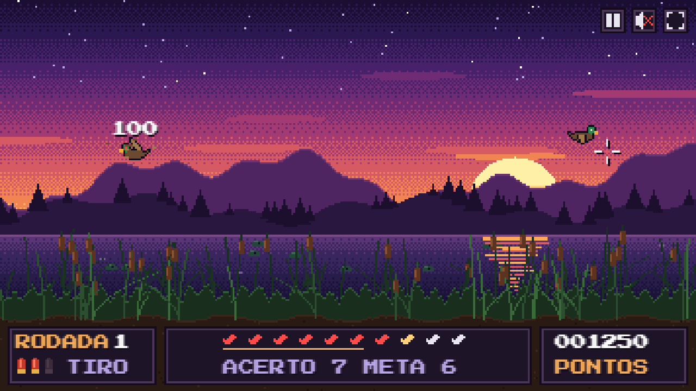
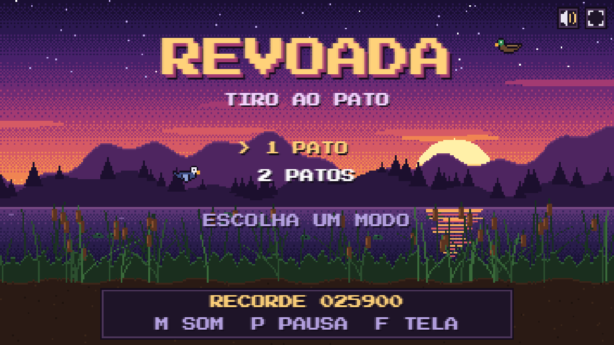
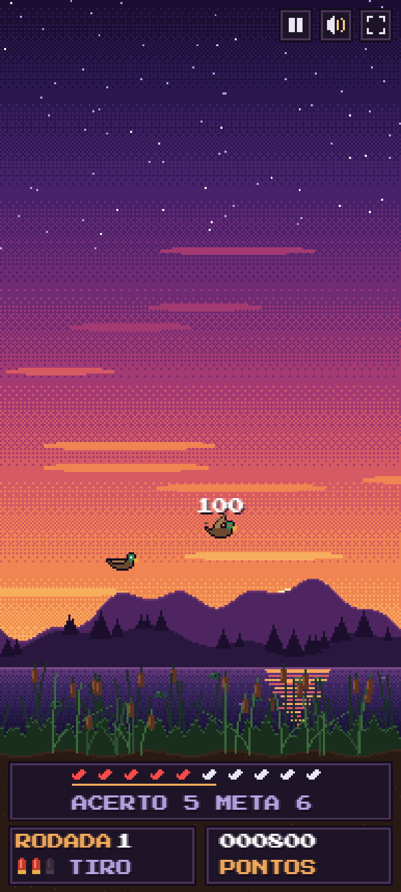
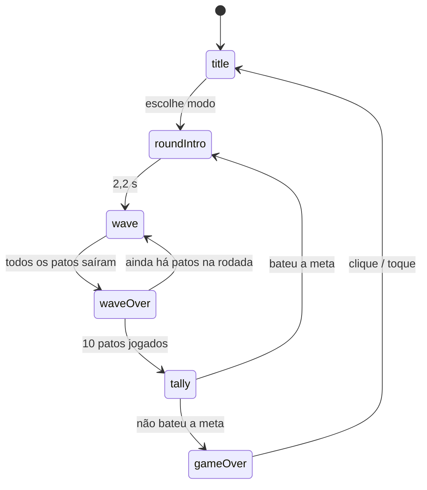

<div align="center">

# 🦆 Revoada

**Jogo de tiro ao pato em pixel art, feito para a web — roda no navegador do PC e do celular.**




</div>

---

## 📖 Sumário

- [Sobre o jogo](#-sobre-o-jogo)
- [Screenshots](#-screenshots)
- [Funcionalidades](#-funcionalidades)
- [Como jogar](#-como-jogar)
- [Como rodar localmente](#-como-rodar-localmente)
- [Jogando no celular](#-jogando-no-celular)
- [Estrutura do projeto](#-estrutura-do-projeto)
- [Como o código funciona](#-como-o-código-funciona)
- [Ajustando a dificuldade](#-ajustando-a-dificuldade)
- [Tecnologias](#-tecnologias)
- [Autor](#-autor)

---

## 🎯 Sobre o jogo

**Revoada** é um jogo arcade de tiro ao alvo ambientado em um lago ao entardecer. Os patos levantam voo do meio do capim e você tem **3 tiros** para derrubá-los antes que fujam. Cada rodada tem **10 patos** e uma **meta mínima de acertos** — se não atingir a meta, o jogo acaba.

Todo o jogo foi escrito em **JavaScript puro**, sem frameworks, bibliotecas ou imagens externas:

- os gráficos são desenhados em pixel art direto no `<canvas>`;
- os sprites dos patos são definidos como "mapas de caracteres" no próprio código;
- todos os sons e músicas são **sintetizados em tempo real** com a Web Audio API.

---

## 🖼️ Screenshots

<table>
  <tr>
    <td width="68%"></td>
    <td width="32%" rowspan="2"></td>
  </tr>
  <tr>
    <td></td>
  </tr>
  <tr>
    <td align="center"><sub>Tela de título e partida no PC (widescreen)</sub></td>
    <td align="center"><sub>Celular em pé, com HUD compacto</sub></td>
  </tr>
</table>

---

## ✨ Funcionalidades

- 🎮 **Dois modos de jogo:** 1 pato ou 2 patos por vez.
- 🔁 **Rodadas infinitas** com dificuldade progressiva (meta, velocidade e tempo).
- 🦆 **Três tipos de pato**, com velocidades e pontuações diferentes.
- 💥 Feedback visual: penas, pontuação flutuante, tremor de tela e céu piscando quando um pato foge.
- 🔊 **Áudio 100% sintetizado:** tiro, grasnado, queda e vinhetas originais.
- 📱 **Totalmente responsivo:** preenche qualquer tela, do monitor ultrawide ao celular em pé.
- 👆 **Suporte a toque**, com área de acerto ampliada para o dedo.
- ⛶ **Tela cheia** por botão ou tecla, e instalável como app (PWA).
- 🏆 **Recorde salvo** no navegador (`localStorage`).
- ⏸️ Pausa automática ao trocar de aba ou janela.

---

## 🕹️ Como jogar

### Regras

1. Escolha um modo: **1 PATO** ou **2 PATOS**.
2. Cada rodada solta **10 patos**, em ondas de 1 ou 2.
3. Cada onda dá **3 tiros**. Se os tiros ou o tempo acabarem, os patos restantes **fogem**.
4. No fim da rodada, os acertos são comparados com a **meta** (a linha laranja no HUD).
   - Bateu a meta → próxima rodada.
   - Acertou **10/10** → **PERFEITO!** e bônus de **+5000 pontos**.
   - Não bateu a meta → **fim de jogo**.

### Patos e pontuação

| Pato | Velocidade base | Pontos |
|:--|:--:|:--:|
| 🟤 Marreco (marrom, cabeça verde) | lenta | **100** |
| 🔵 Pato-azul (azul, cabeça branca) | média | **250** |
| 🟡 Pato-dourado (dourado, cabeça vermelha) | rápida | **500** |

Os patos mais raros e rápidos aparecem com mais frequência nas rodadas avançadas.

### Controles

| Ação | PC | Celular |
|:--|:--|:--|
| Atirar | Clique esquerdo ou `Espaço` | Toque no pato |
| Escolher modo | Clique no menu ou teclas `1` / `2` | Toque no menu |
| Pausar | `P` ou `Esc` | Botão ⏸ no canto superior |
| Som liga/desliga | `M` | Botão 🔊 no canto superior |
| Tela cheia | `F` | Botão ⛶ (entra sozinho ao iniciar a partida no Android) |

---

## 🚀 Como rodar localmente

O jogo é um site estático: não precisa de build nem de instalar dependências. Basta servir a pasta por HTTP.

> ⚠️ **Não abra o `index.html` com duplo clique.** Pelo protocolo `file://`, o navegador bloqueia o carregamento do `game.js` e do `manifest.json`. Use um dos servidores abaixo.

### 1. Clone o repositório

```bash
git clone https://github.com/LuanGomes99/revoada.git
cd revoada
```

### 2. Suba um servidor local (escolha um)

**Python 3** (já vem no macOS/Linux e costuma estar instalado no Windows):

```bash
python -m http.server 8765
```

**Node.js:**

```bash
npx serve -l 8765
```

**VS Code:** instale a extensão *Live Server*, clique com o botão direito em `index.html` e escolha **Open with Live Server**.

### 3. Abra no navegador

```
http://localhost:8765
```

---

## 📱 Jogando no celular

1. Deixe o PC e o celular na **mesma rede Wi-Fi**.
2. No PC, suba o servidor aceitando conexões da rede:

   ```bash
   python -m http.server 8765 --bind 0.0.0.0
   ```

3. Descubra o IP local do PC (`ipconfig` no Windows ou `ip addr` no Linux/macOS).
4. No celular, abra `http://SEU-IP:8765` (ex.: `http://192.168.0.10:8765`).

**Dica:** no menu do navegador, use **"Adicionar à tela inicial"**. O jogo passa a abrir como um app, em tela cheia e sem a barra do navegador. No iPhone esse é o único jeito de ter tela cheia, porque o Safari não permite que a página entre em tela cheia sozinha.

---

## 🗂️ Estrutura do projeto

```
revoada/
├── index.html            # Página: canvas, meta tags mobile/PWA e CSS de tela cheia
├── game.js               # Todo o jogo (render, lógica, áudio, input)
├── manifest.json         # Manifesto PWA (nome, tela cheia, cores, ícone)
├── icon.svg              # Ícone do app / favicon em pixel art
└── docs/
    └── screenshots/      # Imagens usadas neste README
```

---

## 🧠 Como o código funciona

Todo o jogo está em [`game.js`](game.js), dentro de uma única IIFE (`(() => { ... })()`) para não poluir o escopo global. O arquivo está dividido em seções comentadas, na ordem abaixo.

### 1. Resolução lógica dinâmica (`layout()`)

O jogo desenha numa **resolução baixa** (por exemplo, 356×200 no PC) e o CSS amplia o canvas para a tela inteira com `image-rendering: pixelated`, o que mantém os pixels nítidos.

Para preencher **qualquer proporção de tela** sem faixas pretas, `layout()` fixa a menor dimensão e estica a outra:

| Tela | Regra | Exemplo |
|:--|:--|:--|
| Larga (proporção ≥ 1,6) | altura fixa em **200**, largura acompanha a tela | 1920×1080 → 356×200 |
| Alta / quadrada (PC) | largura fixa em **320**, altura acompanha a tela | 768×1024 → 320×427 |
| Celular em pé | largura ≈ metade da tela em px CSS (entre 200 e 320), para escala ~2× | 393×873 → 200×444 |

A cada redimensionamento (`ResizeObserver`, `resize`, `orientationchange`), o cenário é reconstruído e as constantes de cena (`HORIZON`, `BANK`) são recalculadas. Com largura abaixo de 300, o HUD entra no **modo compacto** (duas linhas).

### 2. Áudio sintetizado (`Sfx`)

Não há nenhum arquivo de som. O módulo `Sfx` cria um `AudioContext` no primeiro toque ou clique (exigência dos navegadores) e gera cada efeito com osciladores e ruído:

| Som | Como é feito |
|:--|:--|
| Tiro | ruído branco com filtro passa-baixa em queda + seno grave (o "baque") |
| Grasnado | onda dente-de-serra com *glide* de frequência passando por filtro passa-banda |
| Queda | triângulo descendo de 1400 Hz para 180 Hz |
| Vinhetas | sequências de notas (`'C5'`, `'E5'`...) convertidas em Hz, com melodia em onda quadrada e baixo em triângulo |

### 3. Sprites a partir de texto (`BASE`, `WINGS`, `paint()`)

Os patos são definidos como **grades de caracteres** de 16×14:

```js
'..........khhhk.',   // k = contorno, h = cabeça, e = olho
'kk..kkkkkkkhhhyy',   // b = corpo, w = asa, y = bico
```

O corpo (`BASE`) é combinado com três posições de asa (`up`, `mid`, `down`) para formar a animação de voo. `paint()` converte cada grade em um canvas pequeno usando a paleta de cada tipo de pato, e `flip()` gera as versões espelhadas (voando para a esquerda e caindo de cabeça para baixo). Tudo isso é feito **uma única vez** na inicialização.

### 4. Cenário pré-renderizado (`buildBG()` / `buildFG()`)

O cenário é desenhado uma vez em dois canvas fora da tela (*offscreen*), que depois são copiados a cada quadro:

- **`BG` (fundo):** céu em degradê com **dithering ordenado (matriz de Bayer 4×4)**, que dá o visual retrô de transição entre cores; estrelas, nuvens, sol listrado, duas camadas de montanhas, pinheiros e lago.
- **`FG` (frente):** taboas, faixa densa de capim e margem de lama. Fica **na frente dos patos**, o que cria o efeito de eles saírem do meio do mato e caírem de volta nele.

Um gerador pseudoaleatório com semente fixa (`seeded()`) garante que o cenário seja sempre o mesmo. Só o reflexo do sol na água é animado a cada quadro (`drawLake()`).

### 5. Patos (`class Bird`)

Cada pato é uma pequena **máquina de estados**:

```
fly ──(tiro certeiro)──► hit ──(0,45 s)──► fall ──(chega ao capim)──► removido
 │
 └──(tempo/tiros acabaram)──► escape ──(sai pelo topo)──► removido
```

- Em `fly`, o pato sobe do capim (`rising`) e depois quica nas bordas da área de voo, trocando de direção em intervalos aleatórios.
- A velocidade e a gravidade da queda são proporcionais ao tamanho da tela, então o ritmo fica igual no PC e no celular.

### 6. Fluxo do jogo (objeto `G`)

O estado global fica no objeto `G`, e o fluxo segue uma máquina de estados:



| Função | Responsabilidade |
|:--|:--|
| `newGame(mode)` | zera pontos, inicia a rodada 1 (e a tela cheia no celular) |
| `startRound()` | reinicia os 10 resultados e mostra "RODADA N" |
| `startWave()` | cria 1 ou 2 patos e devolve os 3 tiros |
| `shoot(x, y, touch)` | trata botões, menu, pausa e o tiro em si (*hit test*) |
| `triggerEscape()` | faz os patos restantes fugirem e marca como erro |
| `tally()` | compara acertos com a meta, aplica bônus e salva o recorde |

### 7. Entrada (mouse, toque e teclado)

- Usa **Pointer Events**, que tratam mouse, caneta e toque com o mesmo código.
- `toLogical()` converte a posição na tela (px CSS) para a resolução lógica do jogo.
- O *hit test* usa uma caixa de **±10×9 px** no mouse e **±16×14 px** no toque, pensando no tamanho do dedo.
- Gestos do navegador (zoom, rolagem, toque longo) são bloqueados no canvas.

### 8. Renderização e loop

O loop usa `requestAnimationFrame` com *delta time* limitado a 50 ms, para evitar saltos ao voltar de uma aba inativa. A ordem de desenho em cada quadro é:

1. fundo (`BG`) → reflexo animado do lago
2. patos
3. frente (`FG`) — esconde os patos atrás do capim
4. partículas (penas) e pontos flutuantes
5. HUD → mensagens → botões → mira

O texto usa a fonte **Press Start 2P** (Google Fonts), com fallback para `monospace` caso esteja offline.

### 9. Persistência

O recorde (`revoada.hi`) e a preferência de som (`revoada.mute`) ficam no `localStorage`. O acesso é envolvido em `try/catch`, então o jogo funciona normalmente mesmo em navegação privada.

---

## ⚙️ Ajustando a dificuldade

As regras de progressão ficam em poucas funções no início do bloco de estado de `game.js`:

| Parâmetro | Função | Fórmula | Evolução |
|:--|:--|:--|:--|
| Meta de acertos | `required(r)` | `min(10, 6 + floor((r-1)/3))` | 6 → 10 (a partir da rodada 13) |
| Tempo por onda | `waveLimit(r)` | `max(4, 7 - 0.25·(r-1))` | 7 s → 4 s (a partir da rodada 13) |
| Velocidade | `Bird` | `base × min(2, 1 + 0.07·(r-1))` | até 2× (por volta da rodada 15) |
| Chance de pato raro | `pickType(r)` | dourado: 8% → 25% · azul: 27% → 40% | sobe a cada rodada |

Os atributos de cada pato (pontos, velocidade, tom do grasnado e paleta) ficam no array `TYPES`.

---

## 🛠️ Tecnologias

- **HTML5 Canvas 2D** — renderização em pixel art
- **JavaScript (ES2020+)** — sem frameworks ou dependências
- **Web Audio API** — síntese de todos os sons
- **Pointer Events** — mouse e toque unificados
- **Fullscreen API** e **Web App Manifest** — tela cheia e instalação como app
- **Press Start 2P** (Google Fonts) — tipografia retrô

---

## 👤 Autor

Feito por **Luan Gomes** — [@LuanGomes99](https://github.com/LuanGomes99)
